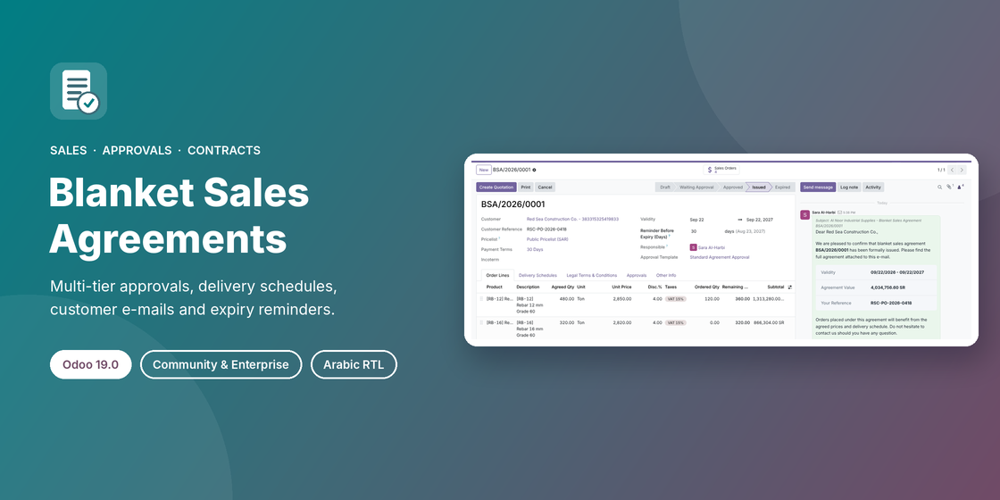

# Advanced Blanket Sales Agreement


Long-term customer agreements for Odoo Sales: agreed products and prices, delivery schedules,
legal terms, multi-tier internal approvals, a formal PDF e-mailed to the customer, and automatic
pre-expiry reminders and expiry notices. Quotations are generated from the agreement, and order
confirmation is checked against the remaining agreed quantity.



**Branches:** [`16.0`](../../tree/16.0) · [`17.0`](../../tree/17.0) · [`18.0`](../../tree/18.0) · **`19.0`**. Each branch holds the module ported to that Odoo version.
This branch: Odoo **19.0**, module version **19.0.1.0.0**.

## Features

- **Off by default.** Enable it in *Sales → Configuration → Settings → Blanket Sales Agreements*.
- **Menu** under *Sales → Orders → Blanket Agreements*; the creator becomes the responsible user.
- **Form tabs:** Order Lines, Delivery Schedules, Legal Terms & Conditions, Approvals, Other Info.
- **Approval templates** with custom roles and sequential tiers. Each tier is approved by a role or a
  specific user, and approvers receive `mail.activity` to-dos. Rejection takes a mandatory reason and
  the agreement can be resubmitted. Approval history is kept per cycle.
- **Segregation of duties** (optional, per company). Nobody approves their own agreement or more than one tier.
- **Issuance** by the responsible user, with the formal agreement PDF e-mailed to the customer.
- **Daily scheduled action** for the pre-expiry reminder (configurable days) and the final expiry notice.
- **Quotations** from agreement lines or delivery schedules, priced at the agreed price and discount.
  On confirmation the ordered quantity cannot exceed the remaining quantity, prices that deviate from
  the agreement are blocked (a Sales Administrator can override, and the override is logged), and
  currencies must match.
- **Locks.** Approved agreements are read-only except for the end date and the delivery schedules.
- **Units.** The line unit is the product unit or one of its packaging units (Odoo 19 has no UoM categories).
- **Record rules** for own, all and approver access, multi-company.
- **Arabic (`ar_001`)** translation (313 terms) and an RTL-safe PDF report.

## Installation

1. Copy the `advanced_blanket_sales_agreement` folder into your addons path, or add this repository
   to the addons path (on Odoo.sh, push this branch to your project as a submodule or folder).
2. Update the Apps list and install **Advanced Blanket Sales Agreement**.
3. Turn the feature on in Sales settings and set up the approval roles and templates.

Depends on `sale_management` and `account`.

```bash
git clone -b 19.0 https://github.com/ibrahim77818/advanced_blanket_sales_agreement.git
```

## Tests

35 automated tests:

```bash
odoo-bin -d <db> -i advanced_blanket_sales_agreement --test-enable \
    --test-tags /advanced_blanket_sales_agreement --stop-after-init
```

## Author

**Ibrahim Yahia**, [LinkedIn](https://www.linkedin.com/in/ibrahim-yahia)

License: [LGPL-3](https://www.gnu.org/licenses/lgpl-3.0.html)

